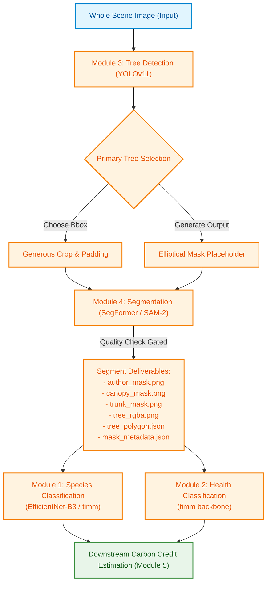

# AI-Powered Tree Carbon Assessment System (Monorepo)

This repository consolidates four independent, specialized Python modules to construct a multi-stage AI pipeline for tree detection, segmentation, and classification, which serves as the core engine for high-integrity tree-by-tree carbon credit estimation.

---

## 1. Pipeline Architecture & Data Flow

The system processes a whole-tree scene image through a sequence of deep learning models, transitioning from coarse detection to segment-level analysis, and finally to fine-grained feature extraction.



---

## 2. Integrated Data Contracts

The pipeline passes data between stages using structured JSON contracts. Below are the contracts for each module's primary inference API.

### Module 3: Tree Detection (`TreeDetector.predict_api()`)
Inputs a scene image; detects candidates; selects the primary tree based on a composite score of area and centrality; crops the candidate with padding; outputs paths to the crop and mask.
```json
{
  "bbox": [124.5, 340.2, 512.0, 980.5],
  "confidence": 0.942,
  "cropped_tree": "outputs/crops/scene_001.jpg",
  "module4_input": "outputs/crops/scene_001.jpg",
  "mask_placeholder": "outputs/crops/scene_001_mask_placeholder.png",
  "selection_rule": "composite_score_area_and_centrality",
  "metadata": {
    "image": "data/raw/scene_001.jpg",
    "image_size": [1920, 1080],
    "num_candidates": 3,
    "crop_resolution": [480, 720],
    "crop_bbox_in_original": [100, 300, 600, 1020],
    "padding_ratio": 0.15
  }
}
```

### Module 4: Tree Segmentation (`TreeSegmenter.predict_api()`)
Inputs the cropped image; segments tree/canopy/trunk; runs a quality gate to prevent bad masks from proceeding; outputs authoritative masks, polygons, and metadata.
```json
{
  "tree_mask": "outputs/results/scene_001/tree_mask.png",
  "tree_rgba": "outputs/results/scene_001/tree_rgba.png",
  "canopy_mask": "outputs/results/scene_001/canopy_mask.png",
  "trunk_mask": "outputs/results/scene_001/trunk_mask.png",
  "polygon": "outputs/results/scene_001/tree_polygon.json",
  "coverage": 0.4578,
  "quality": 0.8845,
  "ready_for_module5": true,
  "metadata": "outputs/results/scene_001/mask_metadata.json"
}
```

### Module 1: Species Classification (`TreeSpeciesPredictor.predict()`)
Inputs a leaf/bark close-up crop; predicts species list and level-1 label.
```json
{
  "image": "data/leaf_crop.jpg",
  "predicted_species": "Quercus_robur",
  "confidence": 0.9142,
  "top_k": [
    {"species": "Quercus_robur", "confidence": 0.9142},
    {"species": "Castanea_sativa", "confidence": 0.0521}
  ]
}
```

### Module 2: Health Classification (`TreeHealthPredictor.predict()`)
Inputs a leaf/bark close-up crop; returns a health state gated by a minimum confidence selector (low score returns `"Unknown"`).
```json
{
  "image": "data/bark_crop.jpg",
  "health": "Healthy",
  "confidence": 0.9754,
  "top_k": [
    {"health": "Healthy", "confidence": 0.9754},
    {"health": "Pest_Affected", "confidence": 0.0246}
  ]
}
```

---

## 3. Environment Strategy & Setup

Due to package dependency differences (e.g. Module 3 using `ultralytics` which installs custom packages, and Module 4 utilizing `sam2` which compiles CUDA/C++ kernels and installs distinct packages), **each module runs inside its own isolated Python virtual environment**. 

To avoid path length limitations on Windows systems (`WinError 206` / `FileNotFoundError`), virtual environments should be created in flat directories near the drive root (e.g., `d:\.venv_m1` to `d:\.venv_m4`), or at the workspace root directory.

### Quick Setup Commands
Run the following PowerShell commands from the monorepo root to initialize and install dependencies for all modules:

```powershell
# Create venvs at workspace root (recommended for short path lengths)
python -m venv ..\.venv_m1
python -m venv ..\.venv_m2
python -m venv ..\.venv_m3
python -m venv ..\.venv_m4

# install Module 1: Species Classification
& ..\.venv_m1\Scripts\pip install -r module1_species_classification\tree_species_classifier\requirements.txt

# install Module 2: Health Classification
& ..\.venv_m2\Scripts\pip install -r module2_health_classification\tree_health_classifier\requirements.txt

# install Module 3: Tree Detection
& ..\.venv_m3\Scripts\pip install -r module3_tree_detection\tree_detection\requirements.txt

# install Module 4: Tree Segmentation
& ..\.venv_m4\Scripts\pip install -r module4_tree_segmentation\tree_segmentation\requirements.txt
```

---

## 4. Execution & Verification

### Syntax Check Verification
To compile all scripts in any module to verify syntax:
```powershell
Get-ChildItem -Path "module1_species_classification" -Filter *.py -Recurse | ForEach-Object { & "..\.venv_m1\Scripts\python.exe" -m py_compile $_.FullName }
```

### Dry-Run Import Verification
Because models require system checkpoints that are typically stored outside Git (e.g., heavy weights files), you can verify that the import chain resolves without `ModuleNotFoundError` using:

```powershell
# Module 1
& ..\.venv_m1\Scripts\python.exe -c "import sys; sys.path.append('module1_species_classification/tree_species_classifier'); from inference.predict import TreeSpeciesPredictor; print('Module 1: OK')"

# Module 2
& ..\.venv_m2\Scripts\python.exe -c "import sys; sys.path.append('module2_health_classification/tree_health_classifier'); from inference.predict import TreeHealthPredictor; print('Module 2: OK')"

# Module 3
& ..\.venv_m3\Scripts\python.exe -c "import sys; sys.path.append('module3_tree_detection/tree_detection'); from inference.detect import TreeDetector; print('Module 3: OK')"

# Module 4
$env:PYTHONPATH="module4_tree_segmentation/tree_segmentation"; & ..\.venv_m4\Scripts\python.exe -c "from inference.segment import TreeSegmenter; print('Module 4: OK')"
```

---

## 5. Architectural Design Notes
- **Venv Isolation**: Decoupling the dependencies prevents version conflicts (e.g. between `omegaconf`, `transformers` and custom `ultralytics` libraries).
- **Trunk Descoping**: For this initial pilot, "trunk" segmentation in Module 4 has been descoped to a 2-class binary architecture (background/canopy) because the primary training dataset (TreeSeg) lacked part-level polygon labels. Generating trunk masks remains future work once Urban Street Tree datasets are fully incorporated.
- **Quality Gates**: Module 4 segments the tree silhouette and computes a quality score using coverage and connectivity metrics. If the segmentation fails this test, the result is rejected by raising a structured error or returning `ready_for_module5: false`, triggering fallback logic in Module 5.
- **Selection Composite Scoring**: When multiple tree candidate bounding boxes are detected by YOLOv11 in Module 3, a composite weighting rule based on box size (area weight) and layout distance from center (center weight) is evaluated to pick the main tree candidate.
